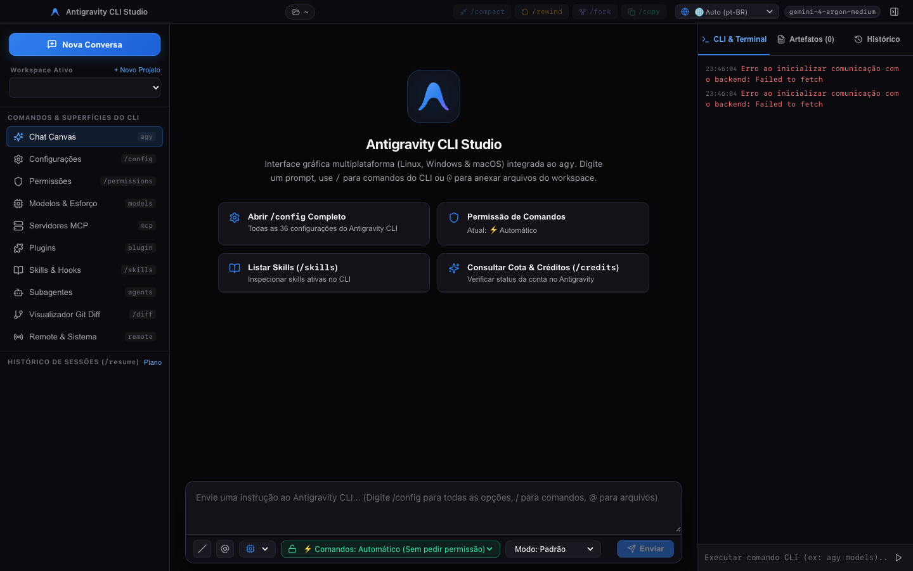

# Antigravity CLI Studio (GUI)

<div align="center">



**Complete Desktop Graphical Interface for Google Antigravity CLI (`agy`) featuring Antigravity 2.0 Visual Identity**

[](package.json)
[](package.json)
[](https://www.electronjs.org/)
[](https://react.dev/)
[](https://www.typescriptlang.org/)
[](https://vitejs.dev/)

<br/><br/>



</div>

---

## 📌 Overview

**Antigravity CLI Studio** is a cross-platform desktop application (macOS, Linux, and Windows) built to provide a modern, intuitive, and feature-rich graphical experience for the **Google Antigravity CLI (`agy`)**.

Inspired by the design system of **Antigravity 2.0 (Obsidian Dark)**, the application transforms terminal commands and flags into responsive graphical controls: dynamic model selection, reasoning effort levels, granular command execution policies, workspace/project management, full module catalogs (MCP, Plugins, Agents, Skills), and an editor for all 36 official configuration options.

---

## ✨ Key Features

### 🎨 1. Antigravity 2.0 Design & Resizable Workspace
- **Obsidian Dark Palette**: High-contrast, sleek theme (`#000000`, `#0B0B0F`, `#121218`) with electric blue accents (`#2F80ED`).
- **Resizable Multi-Panel Layout**:
  - **Left Sidebar**: Session history, project/workspace switcher, quick shortcuts (`/compact`, `/rewind`, `/fork`, `/copy`), and module navigation. Resizable with double-click reset (280px).
  - **Central Canvas**: Real-time conversation stream, monospace prompt responses, syntax-highlighted code blocks, rich Markdown rendering (tables, callout alerts, Mermaid diagrams), and clickable `file://` links.
  - **Right Auxiliary Pane**: Tabbed interface featuring **CLI & Terminal** (with smart auto-scroll and manual pause), **Artifacts** inspector, and **Session History**. Resizable with double-click reset (340px).

### 🌐 2. Native Internationalization (i18n)
- **Automatic OS Locale Detection**: Seamlessly queries the native operating system language via Electron IPC (`app.getLocale()`), with browser fallback (`navigator.language`).
- **Multilingual Support**: Fully localized in **English (`en`)**, **Portuguese (`pt-BR`)**, and **Spanish (`es`)**.
- **Quick Header Switcher**: Switch language instantly from the top-bar dropdown or leave on `Auto (OS)`. Preferences are persisted in `localStorage`.
- **Language-Aware LLM Responses**: User queries in any language are preserved—model responses naturally match the language of your prompt.

### 🧠 3. Interactive Prompt Composer & Controls
- **Dynamic Model Selection (`--model`)**: Detects and displays available models from `agy` (`Gemini 4 Argon`, `Gemini 3.8 Flash`, `Claude Opus 5.5`, `Claude Sonnet 5.5`, `GPT-OSS 120B`, etc.) with integrated reasoning effort indicators (`low`, `medium`, `high`, `xhigh`, `max`).
- **Prompt History Navigation**: Navigate previous prompts quickly using `Up` and `Down` arrow keys.
- **Execution Permission Policies (`toolPermission`)**:
  - `⚡ Automatic`: Executes tools without asking confirmation (`always-proceed` / `--dangerously-skip-permissions`).
  - `✋ Request Review`: Prompts for user approval before tool execution or file modification (`request-review`).
  - `🔒 Sandbox`: Runs commands in an isolated terminal sandbox (`proceed-in-sandbox` / `--sandbox`).
  - `🛡️ Strict`: Requires explicit confirmation for every single step (`strict`).
- **Agent Modes (`--mode`)**: Switch between `Default`, `Auto`, `Accept Edits`, and `Plan`.

### ⚙️ 4. Configuration Center (`/config`)
- Comprehensive graphical editor managing all **36 official Antigravity CLI configuration options**.
- Real-time bidirectional synchronization with `~/.gemini/antigravity-cli/settings.json`.
- Dual scope management: **Global** vs. **Project-Scoped** (`~/.gemini/config/projects/<id>.json`).
- Fast category filtering (General, Agent, Terminal, Network, Security/File Access, UI) and search box.
- Seamless toggle between visual configuration cards and a raw JSON code editor.

### 🧩 5. Extensibility & Modules Ecosystem
- **MCP Servers (`agy mcp`)**: Add, inspect, enable, disable, and configure Model Context Protocol servers.
- **Plugins (`agy plugin`)**: One-click install, validate, import, and delete plugins.
- **Subagents (`agy agents`)**: Survey specialized and custom agent personas.
- **Skills & Hooks**: Context skills management and automated lifecycle hooks.
- **Remote Control (`agy remote-control`)**: Start, monitor status, and terminate remote sessions.

### ⚡ 6. Slash Commands & Shortcuts
- Interactive slash palette triggered by `/` in the prompt or top-bar action buttons:
  - `/config`, `/permissions`, `/model`, `/effort`, `/compact`, `/rewind`, `/fork`, `/diff`, `/skills`, `/mcp`, `/plugin`, `/agents`, `/hooks`, `/tasks`, `/usage`, `/plan`, `/goal`, `/boost`, `/teamwork`, `/grill-me`, `/learn`, `/schedule`, `/browser`, etc.

---

## 🏗️ Project Architecture

```
AntigravityGUI/
├── electron/                  # Electron Main Process & Preload
│   ├── main.ts                # Window creation, native OS locale IPC, lifecycle
│   └── preload.ts             # Secure IPC bridge between Electron and Frontend
├── server/                    # Local Express Server (API Bridge)
│   ├── index.ts               # REST API & SSE streaming endpoints for agy CLI
│   └── agyService.ts          # Process management, config parser, and CLI runner
├── src/                       # Frontend React 19 + TypeScript + Vite
│   ├── components/            # Modular UI components
│   │   ├── AntigravityLogo.tsx
│   │   ├── CliModulesView.tsx # Views for MCP, Plugins, Agents, and Skills
│   │   ├── ConfigView.tsx     # 36-option Configuration Center
│   │   ├── MarkdownRenderer.tsx # GitHub-style Markdown & file link parser
│   │   └── ProjectModal.tsx   # Workspace creation & project settings modal
│   ├── i18n/                  # Complete Internationalization System
│   │   ├── locales/
│   │   │   ├── en.ts          # English translations
│   │   │   ├── es.ts          # Spanish translations
│   │   │   └── pt-BR.ts       # Portuguese (Brazil) translations
│   │   ├── index.tsx          # I18nProvider, useI18n hook, and OS detection
│   │   └── types.ts           # Strictly typed TranslationSchema
│   ├── services/              # API communication layer
│   ├── styles/                # Stylesheets (Obsidian Dark Antigravity 2.0)
│   ├── types/                 # TypeScript type definitions
│   ├── App.tsx                # Main layout, resize handlers, and chat orchestration
│   └── main.tsx               # React application entrypoint
├── public/                    # Static assets and icons
├── package.json               # Dependencies and scripts
├── tsconfig.json              # Frontend TypeScript configuration
├── tsconfig.electron.json     # Electron & Server TypeScript configuration
└── vite.config.ts             # Vite bundler configuration
```

---

## 🚀 Getting Started

### Prerequisites
- **Node.js** (v18.0.0 or higher)
- **npm** or **yarn**
- **Google Antigravity CLI (`agy`)** installed and available in your system `PATH`

### 1. Clone and Install Dependencies

```bash
git clone https://github.com/walterdovalle/AntigravityGUI.git
cd AntigravityGUI
npm install
```

### 2. Development Mode

#### Run as Desktop Application (Recommended):
Starts the local backend server, Vite dev server, and Electron window with Hot Module Replacement (HMR):
```bash
npm run app
```

#### Run in Web Browser Only:
```bash
npm run dev
```
The web frontend will be accessible at `http://localhost:5173`.

---

## 📦 Build & Packaging

The project is preconfigured with `electron-builder` to generate optimized installers for each operating system:

```bash
# Compile TypeScript for both frontend (Vite) and Electron/server
npm run build

# Package installer for macOS (.dmg and .zip)
npm run dist:mac

# Package installers for Linux (.AppImage, .deb, .tar.gz)
npm run dist:linux

# Package installers for Windows (.exe NSIS, Portable, .zip)
npm run dist:win

# Build packages for all target platforms
npm run dist:all

# Automated Release & Multiplatform GitHub Publishing:
# Commits changes, bumps version/tag, pushes to GitHub, and triggers
# native builds on macOS, Linux, and Windows with GitHub Releases attachment
npm run release
```
```

Packaged installers and binaries will be generated in the `release/` directory.

---

## 🛠️ Tech Stack

- **Desktop Framework**: [Electron 34](https://www.electronjs.org/)
- **UI Framework**: [React 19](https://react.dev/)
- **Bundler**: [Vite 6](https://vitejs.dev/)
- **Language**: [TypeScript 5.7](https://www.typescriptlang.org/)
- **Local Backend**: [Express 4](https://expressjs.com/) + [Node.js](https://nodejs.org/)
- **Icons**: [Lucide React](https://lucide.dev/)
- **Markdown & Highlighting**: [react-markdown](https://github.com/remarkjs/react-markdown), [remark-gfm](https://github.com/remarkjs/remark-gfm), [rehype-highlight](https://github.com/rehypejs/rehype-highlight)
- **Packaging**: [electron-builder 25](https://www.electron.build/)

---

## 📄 License

This project is licensed under the **MIT License**. See [`package.json`](package.json) for details.
